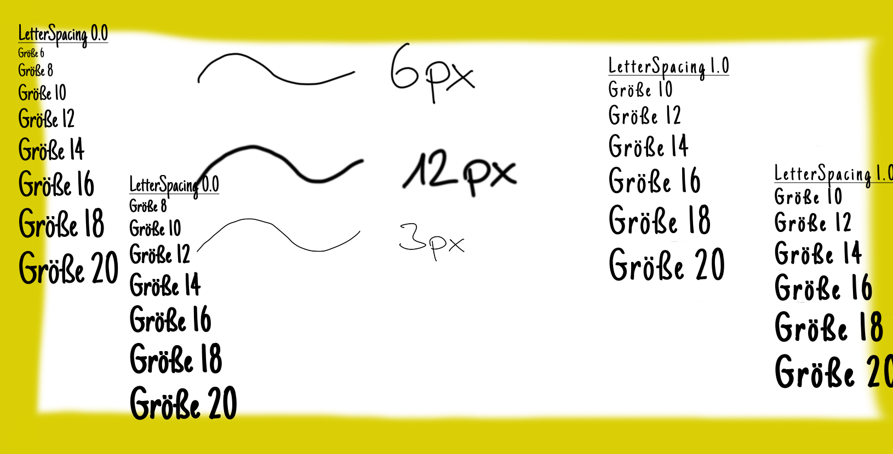
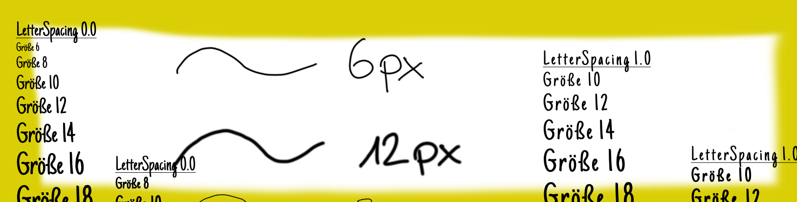
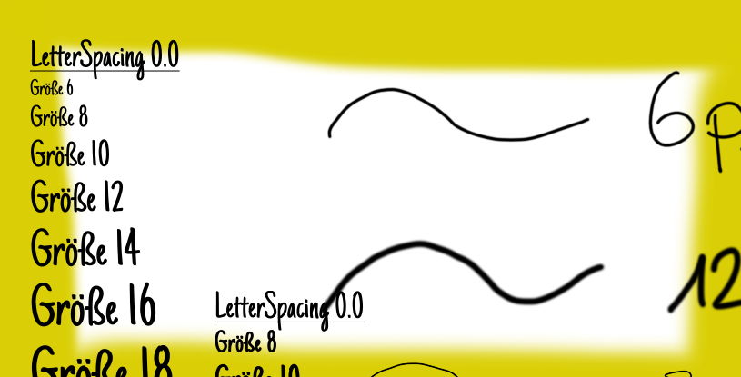
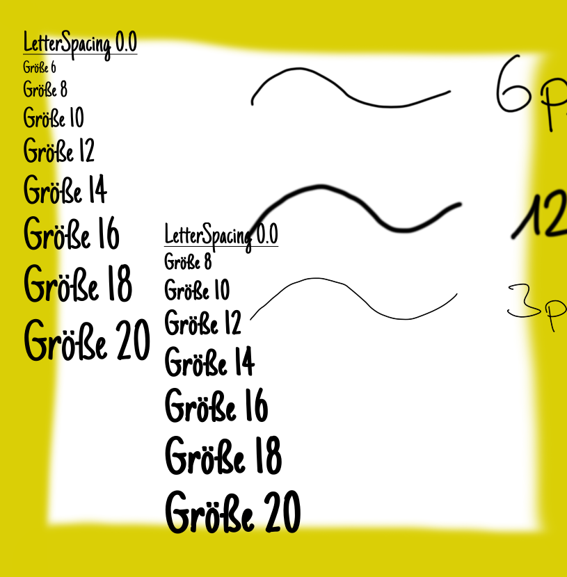

# Einführung

## Ganze Seite

{width="100%"}

## Ganze Seite 2

{width="100%"}

## Viertel Seite

::: columns
::: {.column width="50%"}
Text in der linken Spalte.
:::
::: {.column}
{width="100%"}
:::
:::

::: columns
::: {.column}
{width="100%"}
:::
::: {.column width="50%"}
Text in der rechten Spalte.
:::
:::

## Halbe Seite

::: columns
::: {.column width="50%"}
Das ist eine halbe Seite.
:::

::: {.column}
{width="100%"}
:::
:::

## Tabelle

:::columns
::: {.column}
| Thema                   |       |
|------------------------:|:-----:|
| Einführung              | 1     |
| Grundgleichungen        | 2     |
| Ortsdiskretisierung FDM | 3/4   |
| Turbulenz               | 5/6   |
| Zeitdiskretisierung FDM | 7     |
| FVM                     | 8/9   |
| Turbomaschinen          | 10    |
| Geometrie               | 11    |
| Vernetzung              | 12    |
| Optimierung             | 13/14 |
:::
::: {.column}
| Thema                      |       |
|---------------------------:|:-----:|
| Ortsdiskretisierung (H)    | 1     |
| Zeitdiskretisierung (H)    | 2     |
| Einführung (CFX)           | 3     |
| Backward-Facing-Step (CFX) | 4/5   |
| Simulation Turbine (CFX)   | 6/7   |
| Zylinderumströmung         | 8     |
| Automatisierung            | 9     |
| Vernetzung (H)             | 10    |
| Optimierung                | 11    |
| Rechnerübung Zusatz (CFX)  | 12    |
:::
:::

10 Vorlesungen in 14 x 90 Minuten und 9 Übungen in 12 x 90 Minuten<br>
1 x Institutsbesichtigung und 2 x Offene Sprechstunde

## Komplizierte Formeln
### Unterüberschrift

Eindimensionales Konvektions-Diffusions-Problem
$u\pp{\phi}{x} = \Gamma \pp{}{x}\pp{\phi}{x}$ mit $u,\Gamma=\mathrm{const}$

::: {.r-stack}
:::: {.fragment .fade-in-then-out data-fragment-index="0"}
$$
{\small\begin{aligned}
u \pp{\phi}{x}
  &
  \hide{
    \rightarrow 
      \intV{u\pp{\phi}{x}}
    \rightarrow 
      \intS{u \phi}
    \rightarrow
      - \at{u \phi}{k}
      + \at{u \phi}{k+1} 
  }
  \\
  &
  \hide{
    \rightarrow
      - u \frac{\phi_{m-1} + \phi_{m}}{2}
      + u \frac{\phi_m + \phi_{m+1}}{2}
    \rightarrow
    u\fd{\phi}{m+1}{m-1}{2}
  }
  \\
\Gamma \pp{}{x} \pp{\phi}{x}
  &
  \hide{
    \rightarrow 
      \intV{\Gamma \pp{}{x}\pp{\phi}{x}}
    \rightarrow 
      \intS{\Gamma \pp{\phi}{x}}
    \rightarrow
      - \at{\Gamma\pp{ \phi}{x}}{k}
      + \at{\Gamma \pp{\phi}{x}}{k+1} 
  }
  \\
  &
  \hide{
    \rightarrow
      - \Gamma \fd{\phi}{m}{m-1}{\delta x}
      + \Gamma \fd{\phi}{m+1}{m}{\delta x}
    \rightarrow
    \Gamma \ffd{\phi}{m+1}{m}{m-1}{\delta x}
  }
\end{aligned}}
$$
::::
:::: {.fragment .fade-in-then-out data-fragment-index="1"}
$$
{\small\begin{aligned}
u \pp{\phi}{x}
  &
    \rightarrow 
      \intV{u\pp{\phi}{x}}
    \rightarrow 
      \intS{u \phi}
  \hide{
    \rightarrow
      - \at{u \phi}{k}
      + \at{u \phi}{k+1} 
  }
  \\
  &
  \hide{
    \rightarrow
      - u \frac{\phi_{m-1} + \phi_{m}}{2}
      + u \frac{\phi_m + \phi_{m+1}}{2}
    \rightarrow
    u\fd{\phi}{m+1}{m-1}{2}
  }
  \\
\Gamma \pp{}{x} \pp{\phi}{x}
  &
    \rightarrow 
      \intV{\Gamma \pp{}{x}\pp{\phi}{x}}
    \rightarrow 
      \intS{\Gamma \pp{\phi}{x}}
  \hide{
    \rightarrow
      - \at{\Gamma\pp{ \phi}{x}}{k}
      + \at{\Gamma \pp{\phi}{x}}{k+1} 
  }
  \\
  &
  \hide{
    \rightarrow
      - \Gamma \fd{\phi}{m}{m-1}{\delta x}
      + \Gamma \fd{\phi}{m+1}{m}{\delta x}
    \rightarrow
    \Gamma \ffd{\phi}{m+1}{m}{m-1}{\delta x}
  }
\end{aligned}}
$$
::::
:::: {.fragment .fade-in-then-out data-fragment-index="2"}
$$
{\small\begin{aligned}
u \pp{\phi}{x}
  &
    \rightarrow 
      \intV{u\pp{\phi}{x}}
    \rightarrow 
      \intS{u \phi}
    \rightarrow
      - \at{u \phi}{k}
      + \at{u \phi}{k+1} 
  \\
  &
  \hide{
    \rightarrow
      - u \frac{\phi_{m-1} + \phi_{m}}{2}
      + u \frac{\phi_m + \phi_{m+1}}{2}
    \rightarrow
    u\fd{\phi}{m+1}{m-1}{2}
  }
  \\
\Gamma \pp{}{x} \pp{\phi}{x}
  &
    \rightarrow 
      \intV{\Gamma \pp{}{x}\pp{\phi}{x}}
    \rightarrow 
      \intS{\Gamma \pp{\phi}{x}}
    \rightarrow
      - \at{\Gamma\pp{ \phi}{x}}{k}
      + \at{\Gamma \pp{\phi}{x}}{k+1} 
  \\
  &
  \hide{
    \rightarrow
      - \Gamma \fd{\phi}{m}{m-1}{\delta x}
      + \Gamma \fd{\phi}{m+1}{m}{\delta x}
    \rightarrow
    \Gamma \ffd{\phi}{m+1}{m}{m-1}{\delta x}
  }
\end{aligned}}
$$
::::
:::: {.fragment .fade-in data-fragment-index="3"}
$$
{\small\begin{aligned}
u \pp{\phi}{x}
  &
    \rightarrow 
      \intV{u\pp{\phi}{x}}
    \rightarrow 
      \intS{u \phi}
    \rightarrow
      - \at{u \phi}{k}
      + \at{u \phi}{k+1} 
  \\
  &
    \rightarrow
      - u \frac{\phi_{m-1} + \phi_{m}}{2}
      + u \frac{\phi_m + \phi_{m+1}}{2}
    \rightarrow
    u\fd{\phi}{m+1}{m-1}{2}
  \\
\Gamma \pp{}{x} \pp{\phi}{x}
  &
    \rightarrow 
      \intV{\Gamma \pp{}{x}\pp{\phi}{x}}
    \rightarrow 
      \intS{\Gamma \pp{\phi}{x}}
    \rightarrow
      - \at{\Gamma\pp{ \phi}{x}}{k}
      + \at{\Gamma \pp{\phi}{x}}{k+1} 
  \\
  &
    \rightarrow
      - \Gamma \fd{\phi}{m}{m-1}{\delta x}
      + \Gamma \fd{\phi}{m+1}{m}{\delta x}
    \rightarrow
    \Gamma \ffd{\phi}{m+1}{m}{m-1}{\delta x}
\end{aligned}}
$$
::::
:::

::: {.r-stack}
:::: {.fragment .fade-in-then-out data-fragment-index="0"}
Differential
::::
:::: {.fragment .fade-in-then-out data-fragment-index="1"}
Differential $\rightarrow$ Integral mit Divergenztheorem
::::
:::: {.fragment .fade-in-then-out data-fragment-index="2"}
Differential $\rightarrow$ Integral mit Divergenztheorem
::::
:::: {.fragment .fade-in data-fragment-index="3"}
Differential $\rightarrow$ Integral mit Divergenztheorem $\rightarrow$ lineare Approximation
::::
:::

:::: {.fragment .fade-in data-fragment-index="4"}
$$
{\small
\left(
-\frac{u}{2}-\frac{\Gamma}{\delta x}
\right) \phi_{m-1}
+\left(
\frac{2\Gamma}{\delta x}
\right) \phi_{m}
+\left(
\frac{u}{2}-\frac{\Gamma}{\delta x}
\right) \phi_{m+1} = 0
}
$$
::::

## Gleichungen
### Eine Matrix

FVM liefert
$${\small
\left(
-\frac{u}{2}-\frac{\Gamma}{\delta x}
\right) \phi_{m-1}
+\left(
\frac{2\Gamma}{\delta x}
\right) \phi_{m}
+\left(
\frac{u}{2}-\frac{\Gamma}{\delta x}
\right) \phi_{m+1} = 0
}$$

- Koeffizienten für die $m$-te Zeile
- Analoges Aufstellen für alle anderen Auswertestellen liefern das lineare 
  Gleichungssystem

$$
{\scriptsize
\begin{bmatrix}
\blacksquare & \blacksquare & 0  & \dots & \dots & \dots & 0\\
\blacksquare & \ddots & \ddots & 0 & & & \vdots\\
0 & \ddots & \ddots  & \ddots & 0 &  & \vdots\\
\vdots & 0 & \blacksquare  & \blacksquare & \blacksquare& 0 & \vdots\\
\vdots & & 0 & \ddots & \ddots& \ddots & 0\\
\vdots & & & 0 & \ddots& \ddots & \blacksquare\\
0 & \dots & \dots  & \dots & 0 & \blacksquare & \blacksquare\\
\end{bmatrix}
\begin{bmatrix}
\phi_1 \\
\vdots \\
\phi_m \\
\vdots \\
\phi_N \\
\end{bmatrix}
= \begin{bmatrix}
0 \\
\vdots \\
0 \\
\vdots \\
0 \\
\end{bmatrix}
\mathrm{mit} \; \blacksquare \; \mathrm{für\ Einträge} \neq 0
}
$$

- Matrix hat für den gezeigten Fall eine Bandstruktur
- Matrix ist fast immer schwachbesetzt und die Besetzungsstruktur ist abhängig 
  vom verwendeten Berechnungsgitter

## Turbulenzmodellierung

:::columns
::: {.column}
Hier steht ein Zitat in der Mitte der Spalte.
```{=html}
<center>
```
@krappel_2020
```{=html}
</center>
```
:::
::: {.column}
- Punkt 1
  - Unterpunkt
- Punkt 2
- Punkt 3
- Punkt 4
:::
:::

Text unter der geteilten Seite mit einer Formel in ``\scriptsize``:

$$
{\scriptsize
  \pp{}{t} \uv + 
  \underbrace{
    \uv \cdot \left( \nabla \cdot \uv \right)
  }_{
  \mathrm{nicht-linear}
  } =
  \nu \nabla \cdot \left( \nabla \cdot \underline{u} \right) -
  \frac{1}{\rho} \nabla p
}
$$

Dieser Tensor wird durch Turbulenzmodellierung approximiert.

## Anwendung
### Wasserkraftwerk in Nepal @Hoffmann_2000

Leistungsschwankungen der Turbine verursacht durch die 
Trifurkation

## Matplotlib Schaubild
### Newtonsche und nichtnewtonsche Fluide

Die Schergeschwindigkeit $\dot{\gamma} = \der{u}{y}$ ist proportional zur 
Schubspannung $\tau$. Es gilt $\tau \propto \der{u}{y}$
bzw. $\tau = \mu \der{u}{y}$.
Die Größe $\mu$ wird als dynamische Viskosität oder einfach als Viskosität 
bezeichnet. Oft wird die Viskosität mit der Dichte normiert 
$\nu = \frac{\mu}{\rho}$ und als kinematische Viskosität bezeichnet.

:::{.callout-note}
Ein Newtonsches Fluid hat eine konstante Viskosität. Der Zusammenhang 
zwischen der Schergeschwindigkeit und der Schubspannung ist also linear.
:::

::::columns
:::{.column}
```{python}
#| echo: false
#import matplotlib
#matplotlib.rcParams.update({'font.size': 28})
import matplotlib.pyplot as plt
plt.xkcd()
plt.rc('font', size=18)
import numpy as np
fig = plt.figure(figsize=(5,5))
ax = fig.gca()
ax.set_xlabel(r"SCHERGESCHWINDIGKEIT $\dot{\gamma}$")
ax.set_ylabel(r"SCHUBSPANNUNG $\tau$")
ax.set_xlim([0,1.5])
ax.set_ylim([0,1.5])
ax.set_xticks([])
ax.set_yticks([])
xx = np.arange(0,1.509,0.01)
plt.plot(xx,xx, 'k-', label="Newtonsches")
plt.plot(xx,0.4+1.5*xx, 'r-', label="Bingham")
plt.plot(xx,xx**2.0, 'g-', label="Dilatantes")
plt.plot(xx,np.sqrt(xx), 'm-', label="Strukturviskoses")
ax.legend(bbox_to_anchor=(1.05, 1),loc='upper left', borderaxespad=0.)
```
:::
:::{.column}
```{python}
#| echo: false
#import matplotlib
#matplotlib.rcParams.update({'font.size': 28})
import matplotlib.pyplot as plt
plt.xkcd()
plt.rc('font', size=18)
import numpy as np
fig = plt.figure(figsize=(5,5))
ax = fig.gca()
ax.set_xlabel(r"SCHERGESCHWINDIGKEIT $\dot{\gamma}$")
ax.set_ylabel(r"VISKOSITAET $\mu$")
ax.set_xlim([0,1.5])
ax.set_ylim([0,1.5])
ax.set_xticks([])
ax.set_yticks([])
xx = np.arange(0,1.509,0.01)
plt.plot(xx,0.5+0.*xx, 'k-', label="Newtonsches")
plt.plot(xx,0.6+0.*xx, 'r-', label="Dilatantes")
plt.plot([0.01,0.01,],[0.6, 1.5], 'r-')
plt.plot(xx,0.7*xx**2.0 + 0.1, 'g-', label="Strukturviskoses")
plt.plot(xx,- 0.7*xx**2.0 + 0.9, 'm-', label="Bingham")
#ax.legend(bbox_to_anchor=(1.05, 1),loc='upper left', borderaxespad=0.)
```
:::
::::

:::{.callout-note}
Nichtnewtonsche Fluide können sich deutlich anders verhalten, siehe z.B. 
Weissenberger-Effekt @yt_weissenberger.
:::

## Referenzen

::: {#refs}
:::
